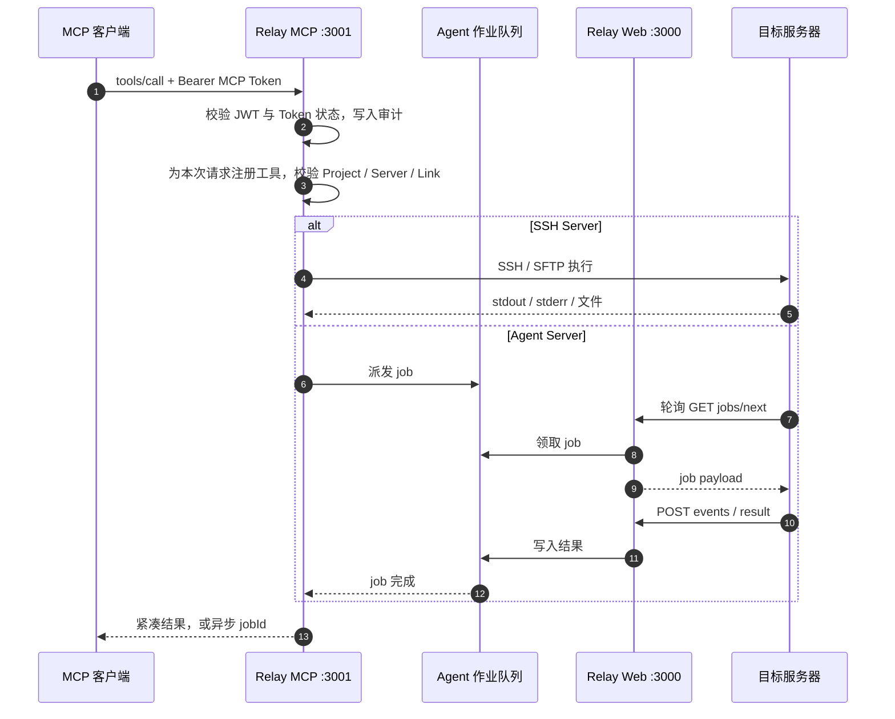

<div align="center">

# Relay MCP

**让 AI 编程助手安全地操作远程服务器、Windows 主机与 SampleManager LIMS 的自托管中继。**

[](https://github.com/tengfei1994/Relay-MCP/releases)
[](https://github.com/tengfei1994/Relay-MCP/commits)
[](#license)

[](https://nodejs.org/)
[](https://www.typescriptlang.org/)
[](https://modelcontextprotocol.io/)
[](https://sqlite.org/)
[](https://github.com/tengfei1994/Relay-MCP/releases)

[项目简介](#项目简介) · [架构总览](#架构总览) · [使用流程](#使用流程) · [工作机制](#工作机制) · [部署与配置](#部署与配置) · [MCP 工具](docs/mcp-tools.md) · [安全边界](#安全边界) · [开发与验证](#开发与验证) · [文档索引](#文档索引)

</div>

> [!IMPORTANT]
> MCP 默认使用 `Authorization: Bearer <token>`。自 v0.6.3 起，`?token=` query 认证默认关闭，因为 query 中的 token 会进入 URL、代理日志、浏览器历史和监控系统。仅当客户端无法发送请求头时，才显式设置 `RELAY_MCP_ALLOW_QUERY_TOKEN=true`。

---

## 项目简介

Relay MCP 是一台自托管的中继服务，位于 MCP 客户端（Codex、Claude、Cursor 等）与目标服务器之间：

- **对上**：暴露标准的 HTTP MCP endpoint，把远程运维、文件传输、部署和 SampleManager 开发能力封装成一组受控工具。
- **对下**：通过 SSH/SFTP，或只需出站 HTTP 的 Windows Relay Agent 操作真实服务器。
- **中间**：用 Project、Server、environment 和 Token 划定权限边界，每次调用都经过范围校验并写入审计。

### 它解决什么问题

| 痛点 | Relay MCP 的做法 |
|---|---|
| AI 助手要操作远程机器，但不能把私钥或管理员账号直接交给它 | 凭据只保存在 Relay；客户端只持有可撤销的 MCP Token，且限定 Project 与 Server 范围 |
| Windows 服务器不开放 SSH / WinRM，只能出站访问 | 部署 Relay Agent，主动轮询 Relay 领取任务并回传结果，无需入站端口 |
| 一个项目对应多台机器（分析 / 开发 / 生产） | Project Server Link 把 environment、Server、远程路径和 LIMS 实例映射起来，调用时只需说 environment |
| SampleManager 多实例、多版本，部署流程长且难回滚 | LIMS Instance 记录路径、数据库、服务和构建工具链；部署通过 `deploymentId` 关联哈希、备份、日志和回滚 |
| 大文件塞进 MCP JSON 又慢又不可靠 | MCP 只创建短期 session；字节流走 HTTP，并校验字节数与 SHA-256 |
| 排查与复盘依赖人的记忆 | 请求审计、Job 记录，以及 Knowledge Plane（Work Session、Wiki、Memory） |

### 适用场景

- 让 Codex / Claude 在受控范围内执行远程命令、读写配置、查日志、重启服务。
- 为 SampleManager LIMS 做诊断、SQL、构建、部署与回滚。
- 在无法开放入站端口的 Windows 服务器上做远程运维。
- 沉淀产品文档、项目事实和运维经验，供 AI 检索（Knowledge Plane）。

---

## 架构总览

<!-- TODO: 在此处插入我方架构流程图（建议放在 docs/assets/architecture.png，插入后删除下方占位块） -->

<div align="center">

> **架构流程图（占位）**
>
> 此处预留给 Relay MCP 我方架构流程图。建议覆盖：MCP 客户端 → Relay MCP → SSH / Relay Agent → 目标服务器，以及 Web UI、`app.db`、`knowledge.db` 和 Workspace。

</div>

### 组件

| 组件 | 端口 / 进程 | 职责 |
|---|---|---|
| Web API + UI | `:3000`，PM2 `remote-ops-web` | 管理界面与 REST API：用户、Server、Project、Token、LIMS Instance、文件上传/下载、Agent 协议端点、Knowledge 页面 |
| MCP endpoint | `:3001/mcp`，PM2 `remote-ops-mcp` | 无状态 HTTP MCP：认证、审计、注册工具、按 Token 范围校验并执行 |
| `app.db` | `DB_PATH`，SQLite | 用户、Server、Project、Link、Token、LIMS Instance 等运营数据 |
| `knowledge.db` | `KNOWLEDGE_DB_PATH`，SQLite | Knowledge Plane 独立数据库，启动时强制与 `app.db` 隔离 |
| Workspace / State | `WORKSPACE_ROOT` / `RELAY_STATE_ROOT` | Project 工作区，以及 job、audit、staging、context 状态 |
| Knowledge 引擎 | PM2 `remote-ops-knowledge-engine`（`KNOWLEDGE_ENGINE_ENABLED=false` 时不启动） | 托管 Knowledge 引擎进程，详见 [运维指南](docs/managed-knowledge-engine-operations.md) |
| Relay Agent | Windows 服务 | 出站轮询 Relay，执行命令与 Playwright，回传结果和 artifact |
| SSH 目标 | — | 通过 SSH / SFTP 直连的机器 |

---

## 使用流程

从零到第一次调用，共 6 步：

| 步骤 | 角色 | 做什么 | 详见 |
|---|---|---|---|
| 1 | 管理员 | 部署 Relay（Web `:3000` + MCP `:3001`），配置 `.env` | [快速部署](#快速部署) |
| 2 | 管理员 | 登记 Server；创建 Project，并按 environment 关联 Server | [初始配置](#初始配置) |
| 3 | 管理员 | Windows 目标机安装 Relay Agent（SSH 目标跳过此步） | [连接目标服务器](#连接目标服务器) |
| 4 | 管理员 | 签发 MCP Token，限定 Project 与 Allowed Servers | [初始配置](#初始配置) |
| 5 | 使用者 | 在 Codex / Claude / Cursor 中配置 endpoint 与 Bearer Token | [接入 MCP 客户端](#接入-mcp-客户端) |
| 6 | AI 助手 | 在对话中调用 MCP 工具；每次调用都经范围校验并写入审计 | [工作机制](#工作机制) |

一个典型对话：

> 「看一下 MyProject 的 analysis 环境最近一小时有什么错误日志。」

AI 助手通常会先调用 `project_server_links_list` 确认 environment 与目标 Server，再调用 `fetch_logs` 读取日志并汇总。

---

## 工作机制

### 对象模型

| 对象 | 含义 |
|---|---|
| **Server** | 一台物理机或虚拟机，连接方式为 SSH 或 Agent |
| **Project** | Relay 工作区和权限边界，可关联多个 Server |
| **Project Server Link** | Project、Server、environment、remote path 与 LIMS Instance 的映射 |
| **LIMS Instance** | 某台 Server 上独立的 SampleManager 实例，保存版本、路径、数据库、服务和构建配置 |
| **MCP Token** | 授权 MCP 客户端访问哪些 Project 和 Server |
| **Agent Token** | 仅用于一个 Relay Agent 注册、轮询 job 和回传结果，不授予 MCP 客户端权限 |

```text
MCP Token ──授权──▶ Project ──Link（environment + remote path）──▶ Server（SSH 或 Agent）
                                                │
                                                └──可绑定──▶ LIMS Instance
```

一个 Project 可以同时关联多台 Server，例如：

| Environment | Server | 用途 |
|---|---|---|
| `analysis` | `A-SERVER` | 只读分析、日志和配置核对 |
| `development` | `B-SERVER` | 编译、部署和测试 |
| `production` | `PROD-SERVER` | 受控生产操作 |

### 一次调用的生命周期



1. **认证**：从 `Authorization: Bearer` 解出 JWT，并核对该 MCP Token 在库中仍处于启用状态。
2. **审计**：记录工具名、分类和脱敏后的参数。
3. **注册**：每个请求创建独立的 MCP Server 并注册工具，工具内部按 Token 范围校验。
4. **目标校验**：见下表。
5. **执行**：SSH Server 走 SSH/SFTP；Agent Server 派发 job，由 Agent 领取执行。
6. **返回**：输出按 `MCP_OUTPUT_LIMIT` 压缩；长任务用 `async: true`，立即返回 `jobId`。

目标校验项（远程工具支持 Project 和 environment 选择，一个 Project 有多个 link 时先调用 `project_server_links_list` 获取准确的 environment、server ID/name 和 remote path，不要猜 UI 显示名）：

- Project 是否在当前 MCP Token 的允许范围内。
- Server 是否在 MCP Token 的 **Allowed Servers** 中。
- Project link 是否存在。
- Agent 是否在线，或 SSH 是否可连接。
- SampleManager 操作是否绑定到明确的 LIMS instance。

### 连接方式：SSH 与 Relay Agent

| | SSH | Relay Agent |
|---|---|---|
| 适用 | Linux、已有 SSH 管理权限、低延迟交互、通用 SFTP | Windows 服务器无法开放 SSH/WinRM，只能向 Relay 发起出站 HTTP |
| 凭据 | Relay 保存连接信息和私钥 | 独立 Agent Token，Agent 端用 DPAPI 加密保存 |
| 方向 | Relay → 目标 | 目标 → Relay（轮询） |
| 执行 | SSH exec / SFTP | Agent job：`exec`、`powershell`、`playwright`、`artifact-upload` |

Agent 使用 Agent Token 访问 `/api/agents/*`：`POST /api/agents/heartbeat` 上报在线；`GET /api/agents/:agentId/jobs/next` 领取下一个 job（无任务返回 204）；`POST /api/agents/:agentId/jobs/:jobId/events` 回传过程事件；`POST /api/agents/:agentId/jobs/:jobId/result` 回传 stdout、stderr 和 exitCode。

### 异步 Job

长时间命令应设置 `async: true`，工具立即返回 `jobId`，随后使用：

- `job_status`：查看 queued/running/completed/failed、结果、错误和近期日志。
- `job_wait`：有界等待终态或阶段变化，到期返回最新快照。
- `job_list`：列出当前用户的近期 job。
- `job_cancel`：请求取消仍在运行的 SSH job。

同步调用超时时，优先查询 job 状态，避免重复执行表转换、DLL 部署、清缓存或服务重启等有副作用的操作。通用远程部署的目标锁定、预检、上传、异步等待、幂等和日志规范见 [`docs/deployment-command-guide.md`](docs/deployment-command-guide.md)。

### 文件传输

大型二进制不经过 MCP JSON。MCP 只创建短期 session，并返回 URL、token、字节数和 SHA-256。

**本地到远端**

```text
local file
  -> create_workspace_upload
  -> HTTP streaming upload to Relay workspace
  -> upload_workspace_file
  -> target server
```

```bash
npm run relay-upload -- --url <url> --token <token> --file <local-file>
```

**远端到本地**

```text
target server
  -> SSH/SFTP staging or Agent artifact-upload
  -> Relay short-lived download
  -> local .part file
  -> byte count + SHA-256 verification
```

`download_remote_file` 在 SSH 模式使用 SFTP staging，在 Agent 模式派发 `artifact-upload` job。下载器支持 HTTP Range 和 `.part` 断点续传：

```bash
npm run relay-download -- --url <url> --token <token> \
  --file <local-file> --expected-bytes <bytes> --expected-sha256 <sha256>
```

短期 session 过期后需要重新调用 MCP 工具。不要把下载 token 写入源码、日志或长期脚本。

### SampleManager 多实例

同一 Server 可以管理多个 SampleManager 实例，包括不同版本、数据库、Windows Service 和构建工具链。

**LIMS Instances > Scan** 执行只读发现：

- 实例目录、文件版本和 runtime 类型。
- 实例所属 Windows Service。
- connection string 候选及数据库证据。
- Visual Studio MSBuild、Framework MSBuild 和 .NET SDK。
- 本地 SQL Server 中符合 SampleManager 核心表特征的业务数据库。

扫描会保留 LocalDB、`EntityContext-*` 和 OData 元数据库作为诊断候选，但不会优先识别为 LIMS 业务库。候选必须经用户审核并导入，之后才能绑定到 Project link。绑定后，SampleManager 工具使用该实例的：

- `Exe`、`Server`、`SolutionAssemblies` 等路径。
- 数据库 host/name/auth 配置。
- Windows Service 与进程范围。
- .NET Framework MSBuild 或现代 `dotnet build` profile。

SQL 查询默认只读。mutation 要求显式参数，并支持 dry run、备份和 before/after 证据。部署操作可通过 `deploymentId` 关联构建、哈希、备份、SQL、日志、重启和回滚状态。

<details>
<summary><strong>构建参数与敏感值规则</strong></summary>

构建工具支持 `preflightOnly`、`msbuildProperties` 和仅限非敏感值的 `environmentVariables`。两类设置的名称只要包含 `TOKEN`、`SECRET`、`PASSWORD`、`PWD`、`PASS`、`KEY`（含 `APIKEY` / `API_KEY`）、`CREDENTIAL`、`AUTH`、`PAT`、`BEARER`、`COOKIE` 或 connection string 等敏感标记就会被拒绝，必须预先配置到目标服务账号。审计、Job 和 deployment metadata 只记录设置键名，不保存值。

绑定实例时自动注入 `SAMPLEMANAGER_EXE` 和 `<INSTANCE>_EXE`；后者把实例名转为大写 ASCII，非字母数字字符替换为 `_`，首字符不是字母或 `_` 时前置 `_`，因此始终是合法的 MSBuild 属性名。

</details>

### Knowledge Plane

Knowledge Plane 是 Relay 内独立的知识层（独立 `knowledge.db`），把运维过程和产品文档沉淀为可检索、可审核的知识。Product Document 是唯一的产品文档领域对象：

| 层 | 职责 |
|---|---|
| **Product Document** | 保存规范化正文、Solution、Module、Topic、版本、语言、来源和 ACL |
| **Engine projection** | 保存外部文档 ID、Chunk、解析/验证/失败状态、模型 provenance 和索引状态 |
| **Wiki** | 组织跨版本的 Common、Version、Difference 章节，保存逐章节来源引用；一个 `topic_group_id` 对应一个 Wiki 页面 |

同一主题的多个版本合并为一个 Wiki 页面：

```text
Topic Wiki
├── Common       ← 所有版本都成立，引用每个代表版本
├── Version 21.1 ← 仅引用 21.1 的文档/Chunk
├── Version 21.3 ← 仅引用 21.3 的文档/Chunk
└── Differences  ← 只描述版本差异，至少引用两个版本
```

Product import 会自动排队后台 `wiki_generation`，由 managed `wiki_llm` 生成带章节级来源引用的 draft Wiki；生成失败保留状态、错误和尝试次数，不会产生无来源的 fallback 内容，Review/Publish 仍是独立的人工动作。管理员也可在 **Knowledge → Wiki** 点击 **Generate all**（`POST /api/knowledge/wiki/generation`）重新排队缺失和失败的 topic group。

Job 和 Deployment 仅通过失败隔离的 domain-event outbox 通知 Knowledge Plane：知识库不可用时，不会影响远程执行、部署、审计或回滚主路径。

实现与运维细节见 [Knowledge base architecture](docs/knowledge-base-architecture.md)、[Managed Knowledge engine operations](docs/managed-knowledge-engine-operations.md) 和 [质量基线](docs/knowledge-quality-baseline.md)。

---

## 部署与配置

### 快速部署

要求：Linux Relay 主机、Node.js 20+、npm 和 PM2。

```bash
git clone https://github.com/tengfei1994/Relay-MCP.git ~/Relay-MCP
cd ~/Relay-MCP
npm install
npm --prefix frontend install
cp .env.example .env
npm run build
mkdir -p logs
pm2 start ecosystem.config.cjs
pm2 save
```

至少修改 `.env` 中的 `JWT_SECRET` 和 `RELAY_PUBLIC_URL`。默认 Web 端口是 `3000`，MCP 端口是 `3001`。

```bash
curl http://127.0.0.1:3000/api/health
curl http://127.0.0.1:3001/mcp/health
```

更新已有部署：

```bash
cd ~/Relay-MCP
git pull --ff-only
npm install
npm --prefix frontend install
npm run build
pm2 restart remote-ops-web remote-ops-mcp --update-env
pm2 save
```

### 初始配置

打开 `http://<relay-host>:3000`。第一个注册用户自动成为管理员，然后按以下顺序配置：

1. **Servers**：创建 SSH Server，或创建带 `agentId` 的 Agent Server。
2. **Projects**：独立创建 Project，并按 environment 关联一个或多个 Server。
3. **LIMS Instances**：对 Agent Server 执行只读扫描，审核候选结果后再导入并绑定到 Project link。
4. **MCP Tokens**：为 Codex 等客户端创建 token，配置 Project 范围、Allowed Servers 和可选默认目标。
5. **Agent Tokens**：为每个 Agent 创建独立 token；token 只显示一次。

### 连接目标服务器

**SSH**：Relay 保存连接信息和私钥，Project link 保存 environment 与 remote path。

**Relay Agent**（Windows）：

1. 从 [Release](https://github.com/tengfei1994/Relay-MCP/releases/tag/v0.6.3) 下载 `RelayAgent.Client.exe`。
2. 在目标 Windows Server 上以管理员身份运行。
3. 输入 Web API 地址，例如 `https://relay.example.com`，不要填写 `/mcp`。
4. 输入 Server 中配置的 Agent ID 和对应 Agent Token。
5. 保存配置，执行 **Install Service**，然后 **Start**。

Relay URL 和 Agent Token 使用 Windows DPAPI `LocalMachine` 范围加密。安装为服务后，界面程序可以关闭，Windows Service 会继续运行。Agent 配置、日志和审计文件位于：

```text
%ProgramData%\RelayMcpAgent\
```

### 接入 MCP 客户端

```text
http://<relay-host>:3001/mcp
Authorization: Bearer <MCP_TOKEN>
```

**Codex**：在 `C:\Users\<you>\.codex\config.toml` 中配置：

```toml
[mcp_servers.relay_mcp]
url = "http://<relay-host>:3001/mcp"
bearer_token_env_var = "RELAY_MCP_TOKEN"
startup_timeout_sec = 20
tool_timeout_sec = 120
enabled = true
default_tools_approval_mode = "prompt"
```

设置用户环境变量后完整重启 Codex：

```powershell
[Environment]::SetEnvironmentVariable("RELAY_MCP_TOKEN", "<MCP_TOKEN>", "User")
```

**其他客户端**：原生支持 HTTP MCP 的客户端直接使用 endpoint 和 Bearer token。只支持 stdio 的客户端可以使用 `mcp-remote`：

```json
{
  "mcpServers": {
    "relay-mcp": {
      "command": "npx",
      "args": [
        "-y",
        "mcp-remote",
        "http://<relay-host>:3001/mcp?token=<MCP_TOKEN>",
        "--allow-http"
      ]
    }
  }
}
```

该示例使用的 `?token=` 属于 legacy 传输，默认已禁用，需要显式设置 `RELAY_MCP_ALLOW_QUERY_TOKEN=true` 才可用。生产环境应使用 HTTPS，优先使用 `Authorization: Bearer`，并通过反向代理限制 Web 与 MCP 入口。

### 环境变量

<details>
<summary><strong>完整环境变量表</strong></summary>

| 变量 | 默认值 | 用途 |
|---|---|---|
| `PORT` | `3000` | Web API/UI 端口。 |
| `MCP_PORT` | `3001` | MCP HTTP endpoint 端口。 |
| `JWT_SECRET` | 必填 | Web JWT 与 token 签名密钥。非 `development`/`test` 环境下未设置会拒绝启动。 |
| `RELAY_MCP_ALLOW_QUERY_TOKEN` | `false` | 是否允许 `/mcp?token=` legacy query 认证（仅无法设置请求头的客户端）。 |
| `MCP_SECRET` | 可选 | MCP 相关独立 secret。 |
| `MCP_OUTPUT_LIMIT` | `12000` | 工具紧凑输出字符上限。 |
| `RELAY_MCP_VERSION` | `0.6.3` | MCP server 与 `/mcp/health` 使用的协议元数据版本。 |
| `DB_PATH` | `./data/app.db` | SQLite 数据库路径。 |
| `KNOWLEDGE_DB_PATH` | `${RELAY_STATE_ROOT}/knowledge.db` | 独立 Knowledge SQLite 路径；不能与 `DB_PATH` 指向同一规范化文件。 |
| `KNOWLEDGE_CAPTURE_INTERVAL_MS` | `1000` | Knowledge Capture Worker 轮询间隔（250–60000）。 |
| `KNOWLEDGE_OUTBOX_PRUNE_INTERVAL_MS` | `3600000` | Knowledge outbox retention 清理间隔（60000–86400000）。 |
| `KNOWLEDGE_OUTBOX_RETENTION_MS` | `2592000000` | Knowledge outbox 保留时长（至少 1 小时）。非法值回退到 30 天。 |
| `KNOWLEDGE_CONSUMER_HEARTBEAT_MS` | `604800000` | Knowledge consumer 活跃租约时长（默认 7 天）；超过租约未 heartbeat 的 consumer 不会永久阻塞 outbox retention。 |
| `RELAY_MCP_SHUTDOWN_GRACE_MS` | `10000` | MCP 收到 SIGTERM/SIGINT 后等待 HTTP 连接关闭的最长毫秒数（250–60000）；超时后会关闭连接并退出。 |
| `WORKSPACE_ROOT` | `/workspace` | Project workspace 根目录。 |
| `RELAY_STATE_ROOT` | `/workspace/.relay-mcp` | job、audit、staging 和 context 状态目录。 |
| `SSH_KEYS_DIR` | `/workspace/.ssh-keys` | Relay SSH key 目录。 |
| `RELAY_PUBLIC_URL` | `http://localhost:<PORT>` | 上传/下载 session 返回的公网 Web API base URL。 |
| `RELAY_UPLOAD_TTL_MS` | `900000` | 上传 session 有效期。 |
| `RELAY_UPLOAD_MAX_BYTES` | `4294967296` | 流式上传最大字节数。 |
| `RELAY_ARTIFACT_MAX_BYTES` | `4294967296` | Agent artifact 最大字节数。 |
| `RELAY_DOWNLOAD_TTL_MS` | `900000` | 下载 session 有效期。 |
| `RELAY_VERSION` | `0.6.3` | `/api/health` 返回的版本。 |
| `RELAY_BUILD_COMMIT` | `development` | 部署 commit fingerprint。 |
| `RELAY_BUILD_TIME` | `unknown` | 构建时间 fingerprint。 |

端口转发场景中，`RELAY_PUBLIC_URL` 必须填写客户端实际可访问的 Web 地址。例如公网 `7230` 转发到内网 `3000` 时：

```dotenv
RELAY_PUBLIC_URL=http://relay.example.com:7230
```

MCP 客户端则连接公网 MCP 端口，例如 `http://relay.example.com:7231/mcp`。

</details>

---

## MCP 工具

Relay MCP 暴露的工具分为 8 类：Project、Remote execution、Remote files、Workspace、Jobs、Playwright、Context、SampleManager。各分类的职责、典型工具和选用思路见 **[docs/mcp-tools.md](docs/mcp-tools.md)**。权威清单是 `src/shared/tool-catalog.ts` 和运行时的 `tools/list`。

---

## 安全边界

- MCP Token 与 Agent Token 分离，均可在后台撤销。
- MCP Token 的 Project 范围与 Allowed Servers 分别校验。
- Agent 只主动访问 Relay，不需要开放入站 SSH 或 WinRM。
- Agent Client 使用 DPAPI 加密 Relay URL 和 Agent Token。
- 请求审计会脱敏 Authorization、token、password、secret、API key 和 connection string。
- 大型文件使用短期 session；URL/token 过期后不可继续访问。
- SQL 默认只读；mutation、目录树删除、部署和回滚需要显式调用。
- 生产环境应使用 HTTPS、强 `JWT_SECRET`、最小权限账号和受限网络入口。

---

## 开发与验证

```bash
npm install
npm --prefix frontend install
npm test
npm run build
```

常用开发命令：`npm run dev:server`、`npm run dev:mcp`。技术栈：Node.js、TypeScript、Fastify、Express、MCP SDK、SQLite/Drizzle、React、Vite、Tailwind CSS、PM2、node-ssh，以及 Windows WPF/.NET Agent。

### 代码布局

| 路径 | 内容 |
|---|---|
| `src/mcp/` | MCP 入口（HTTP Transport、认证、审计、依赖组装）、`register-tools.ts`，以及 `tools/` 下按域划分的工具 registrar |
| `src/server/` | Fastify Web API：`routes/`、`db/`、迁移和 Knowledge 引擎启动 |
| `src/shared/` | Job/Deployment store、SSH 与 Agent runner、工具目录 `tool-catalog.ts` 等共享逻辑 |
| `src/knowledge/` | Knowledge Plane：store、迁移、Work Session、Capture/Ingest Worker |
| `frontend/` | React + Vite + Tailwind 管理界面 |
| `agent/windows/` | Windows Relay Agent |
| `scripts/`、`tests/`、`docs/` | 脚本、测试、文档 |

### MCP 组合根约束

`src/mcp/index.ts` 只处理 HTTP Transport、认证、依赖组装和审计入口；工具注册位于 `src/mcp/register-tools.ts` 和 `src/mcp/tools/`。新增工具必须放入相应的域 registrar，并登记到 `src/shared/tool-catalog.ts`，不能直接追加到入口文件。

`npm test` 和 `npm run build` 会自动运行 `npm run check:mcp-boundary`：限制 `src/mcp/index.ts` 不超过 350 行，禁止在其中直接注册工具，并校验 registrar 工具名与 `TOOL_CATALOG` 完全一致。`tests/fixtures/mcp-tools-baseline.json` 冻结运行时 `tools/list` 的 schema、描述、注解、别名与能力元数据；只有在评审过有意的契约变更后才重新生成：

```bash
npm run generate:mcp-baseline
```

快照会记录来源 Git commit、MCP SDK 版本、生成命令、时间，以及生成时工作区是否有未提交改动。

### 前端

Web UI 使用顶部主导航与 Knowledge 二级导航；项目级页面通过顶部项目范围选择器共享持久化的 `knowledge.projectId`。记录详情、Provider 配置与审核操作使用可键盘操作的 Drawer/Dialog。设计令牌与实现约束见 [前端重设计规格](docs/frontend-redesign-spec.md)，视觉参考见 [Knowledge Overview 参考页](docs/design/knowledge-overview-reference.html)。字体通过 `frontend` 的本地 `@fontsource` 依赖加载，不依赖 Google Fonts。

```bash
npm --prefix frontend run build
cd frontend && npx tsc --noEmit --jsx react-jsx --module ESNext --moduleResolution bundler --target ES2022 --strict --skipLibCheck src/main.tsx
```

---

## 文档索引

| 主题 | 文档 |
|---|---|
| MCP 工具分类 | [docs/mcp-tools.md](docs/mcp-tools.md) |
| 通用远程部署规范 | [docs/deployment-command-guide.md](docs/deployment-command-guide.md) |
| SampleManager 部署流程 | [docs/samplemanager-knowledge-enabled-deployment-flow.md](docs/samplemanager-knowledge-enabled-deployment-flow.md) |
| Knowledge 架构 | [docs/knowledge-base-architecture.md](docs/knowledge-base-architecture.md) |
| Managed Knowledge 引擎运维 | [docs/managed-knowledge-engine-operations.md](docs/managed-knowledge-engine-operations.md) |
| Managed Knowledge 变更说明 | [docs/managed-knowledge-engine-release-notes.md](docs/managed-knowledge-engine-release-notes.md) |
| Knowledge 治理（审核、晋级、Evidence、Skill diff） | [docs/knowledge-governance.md](docs/knowledge-governance.md) |
| Knowledge 检索质量基线 | [docs/knowledge-quality-baseline.md](docs/knowledge-quality-baseline.md) |
| Product 导入运维 | [docs/product-import-operations.md](docs/product-import-operations.md) |
| Case / Pattern / Playbook 模板 | [docs/templates/](docs/templates/) |
| 验证报告 | [docs/verification/managed-engine-progress.md](docs/verification/managed-engine-progress.md) |
| 前端设计规格 | [docs/frontend-redesign-spec.md](docs/frontend-redesign-spec.md) |

---

## 更新要点

<details>
<summary><strong>v0.6.3</strong></summary>

- Product Document 成为唯一的产品文档领域对象，索引引擎字段作为同一对象的 projection。
- 同一 `topic_group_id` 的多版本内容合并为一个 Wiki 页面，并按 Common / Version / Differences 组织。
- Product import 自动排队后台 `wiki_generation`，生成带章节级来源引用的 draft Wiki。
- Wiki 前端提供 Solution → Module → Topic 目录、版本筛选、稳定 TOC 和生成状态。
- Agent 通过 `artifact-upload` job 将远程文件流式上传到 Relay，不再把大型二进制塞进 Base64/JSON。
- 下载接口支持 HTTP Range，本地下载器使用 `.part` 文件断点续传。
- 文件传输返回并校验字节数和 SHA-256。
- `/api/health` 返回版本、Git commit 和构建时间，便于确认实际运行版本。
- 提供单文件 WPF Windows Agent Client，包含服务控制、数据库权限、请求审计、日志和更新管理。
- 兼容性变更：`?token=` query 认证默认关闭。

[Release 与 Windows Agent 下载](https://github.com/tengfei1994/Relay-MCP/releases/tag/v0.6.3)

</details>

## License

MIT
