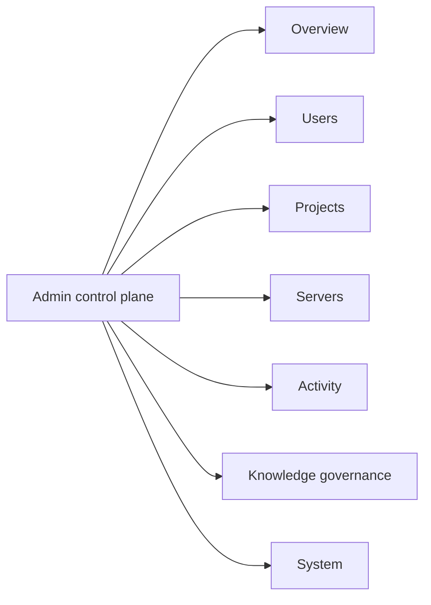
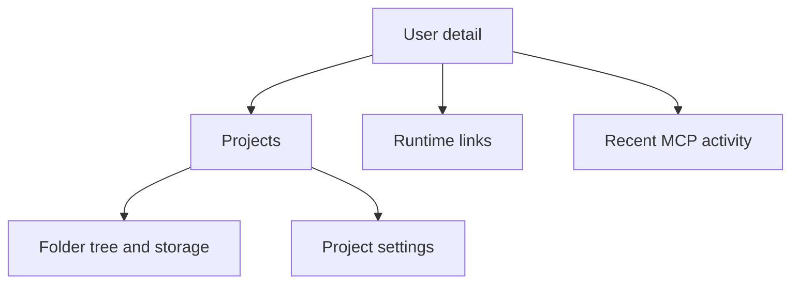

# Relay MCP 管理控制台重构提案

## 目标

管理员需要观察和管理整个 Relay 实例，而不是进入一个普通用户工作区。管理员首页围绕系统运行状态、用户资源、项目资源、服务器资源和 MCP 审计展开。

用户首页保留项目工作流、运行记录和 Knowledge 使用入口。管理员首页只保留管理决策需要的信息。

## 管理员导航

管理员登录后使用独立的控制面导航。

顶部导航继续提供产品级入口。左侧上下文栏改为管理员专属入口，不显示普通用户的 Selected workspace、Activity 或 Runtime 入口。

## Overview 页面

页面第一屏回答四个问题。

### 系统状态

使用状态卡片显示 API、数据库、MCP、Knowledge engine 和后台 worker。

- API process and response time
- SQLite database health
- MCP listener health
- Knowledge engine state
- Background jobs and dead letters
- Host memory used and available
- Workspace disk used, free and capacity

卡片点击后进入 System 页面，展示检查时间、最近错误和恢复动作。

### 用户状态

显示 active、pending、disabled 用户数量和最近登录时间。列表展示用户名、角色、Knowledge 权限、项目数、占用空间和最近 MCP 活动时间。

用户行点击后进入用户详情页。详情页包含用户拥有的项目、每个项目的目录统计、服务器绑定和调用历史。

### 项目状态

显示项目总数、最近更新项目、存储占用最高项目和无运行时绑定项目。

项目表格包含项目名、所有者、文件夹数、文件数、磁盘大小、运行时绑定数、最近活动时间和状态。

项目详情页提供目录树。目录树展示每个文件夹的文件数、大小、最近修改时间和占用比例。管理员可以从项目详情进入文件预览和 MCP 活动过滤。

### 运行资源

显示服务器、实例和 Agent 的连接状态。每个资源显示所属用户、绑定项目、最近心跳和失败原因。

## Activity 页面

Activity 是管理员审计视图，展示 MCP 调用和管理操作的时间线。

每条记录包含以下信息。

- 时间
- 用户
- 项目
- MCP tool
- 目标服务器或实例
- 只读或变更类型
- 成功、失败或进行中
- 执行耗时
- 关联 job、deployment 或 work session

默认按最近时间排序。过滤条件包括用户、项目、tool family、服务器、结果状态和时间范围。参数只显示经过现有审计清洗的摘要，不能把 token、密码、命令中的敏感值带进管理员页面。

## 用户详情页

用户详情页以用户为主线组织内容。

页面顶部显示账号状态、角色、Knowledge 权限、创建时间、最近活动和项目总占用。

Projects 区域展示所有项目的资源统计。每个项目可展开目录树，点击文件进入已有安全预览入口。

Recent MCP activity 区域展示该用户的最近调用，点击记录进入调用详情。

## 后端接口规划

当前接口无法支持上述管理员视角，需要新增 Admin-only API。

### `GET /api/admin/overview`

返回系统状态摘要、用户计数、项目计数、服务器计数、存储计数和最近活动摘要。

### `GET /api/admin/users`

返回管理员可见的用户列表。每行附带项目数、文件数、磁盘大小、最近活动和运行时绑定数。

### `GET /api/admin/users/:id`

返回用户详情、项目列表、服务器绑定和活动摘要。

### `GET /api/admin/projects`

返回跨用户项目列表和每个项目的文件统计。

### `GET /api/admin/projects/:id/tree`

返回受边界限制的目录树和文件元数据。扫描结果需要缓存，并返回扫描时间和是否完整。

### `GET /api/admin/activity`

读取清洗后的 MCP 调用和管理操作审计。支持用户、项目、tool、服务器、状态、时间范围和分页过滤。

### `GET /api/admin/system`

返回 API、数据库、MCP、Knowledge engine、worker、内存和磁盘状态。

## 数据与权限边界

管理员接口只允许 `isAdmin` 用户访问。项目目录扫描在服务端执行，前端不直接读取工作区路径。目录大小使用有上限的递归扫描，返回 `scanStatus` 和 `scannedAt`。审计接口沿用现有敏感参数清洗逻辑，页面只展示摘要字段。

## 实施顺序

1. 新增 Admin-only overview、users、projects、activity 和 system 接口。
2. 先实现 Admin Overview 和独立管理员导航。
3. 实现用户详情和项目目录树。
4. 接入 MCP 活动审计和筛选。
5. 最后补齐服务器、实例和 Knowledge governance 的管理卡片。

## 验收重点

- 管理员首页不再复用用户工作区或 Landing 内容。
- 管理员能从用户进入项目、目录大小和最近 MCP 活动。
- 管理员能从项目进入所有者、目录树、运行时和活动。
- 系统状态、内存、磁盘和后台任务使用真实服务端数据。
- 普通用户不能看到跨用户项目、目录和 MCP 审计。
